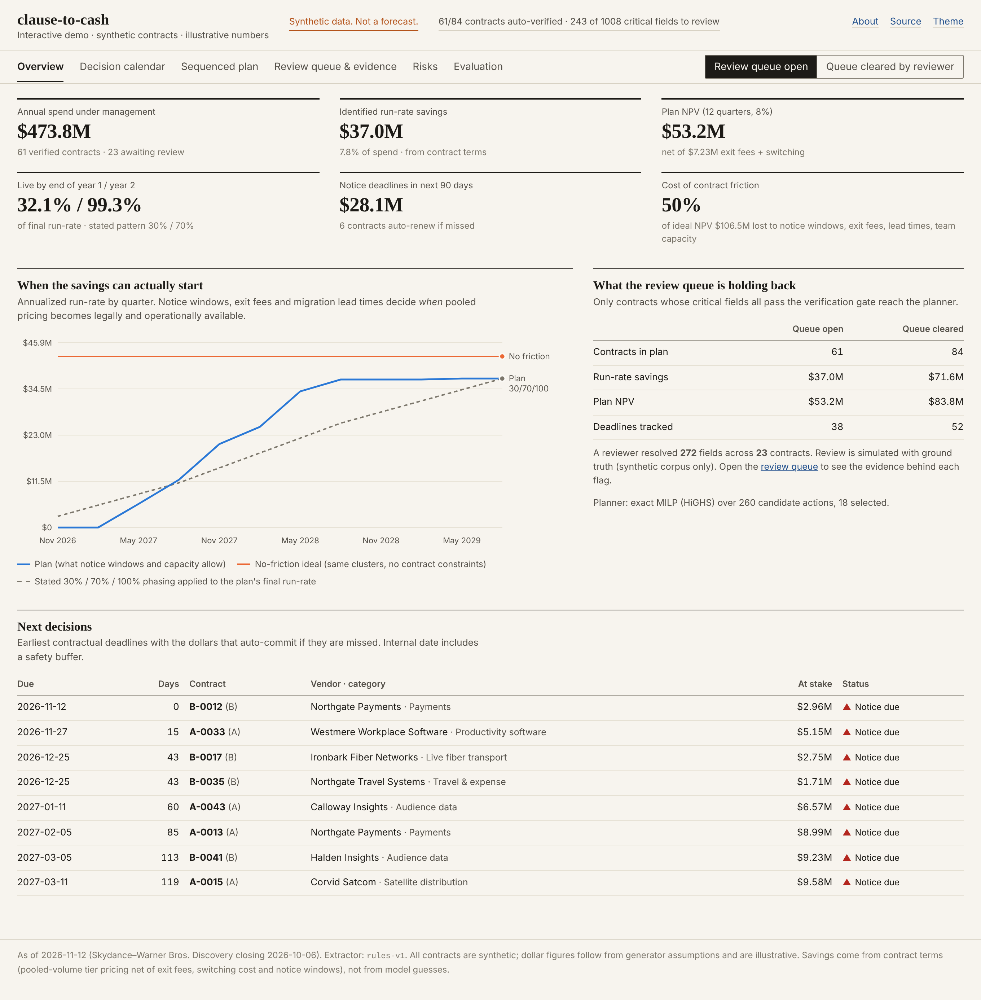

# clause-to-cash-engine

[](https://github.com/mkhambatti/clause-to-cash-engine/actions/workflows/ci.yml)
[](LICENSE)

**A guardrailed document-intelligence pipeline for vendor contracts: probabilistic LLM extraction, gated by deterministic verification, exposed to agents over the Model Context Protocol.**

[**Live demo**](https://mkhambatti.github.io/clause-to-cash-engine/demo/) · [Project page](https://mkhambatti.github.io/clause-to-cash-engine/) · [Evaluation](docs/EVALUATION.md) · [Architecture](docs/ARCHITECTURE.md) · [Product brief](docs/PRODUCT_BRIEF.md)

[](https://mkhambatti.github.io/clause-to-cash-engine/demo/)

> Everything here runs on **synthetic contracts** (84 fictional agreements with ground truth). Real vendor contracts are confidential. Dollar figures follow from generator assumptions and are illustrative, not a forecast. See [Limitations](#limitations-read-this).

---

## The hook

**The problem.** Enterprises lose money to operational friction because the facts that drive it are trapped in unstructured contracts: when a renewal locks in, what notice a termination needs, whether two business units may pool volume. Traditional OCR/RPA is brittle: it breaks on the first unfamiliar template. Vanilla LLMs read any layout, but they hallucinate the high-stakes fields (renewal dates, notice periods, termination rights, commit floors, price tiers) with the same confidence they get the easy ones right.

**The solution.** A production-shaped, guardrailed pipeline that couples probabilistic LLM extraction with strict deterministic verification gates. Every extracted value must arrive with a verbatim quote, and code, not the model, decides whether the quote exists, supports the value, and is consistent with everything else in the document. Only verified terms reach the date math, the price math and the planner. All of it is exposed natively through an MCP server whose tools refuse to answer when their inputs are unverified.

What the gate does in practice (`python scripts/worked_example.py`): one synthetic contract, three plausible extractor errors, each delivered with 90-95% confidence.

| error | what the extractor returned | gate verdict |
|---|---|---|
| invented evidence | `initial_term_months = 36`, with a quote that is not in the document | `UNGROUNDED` |
| the silent miss | `change_of_control = "silent"`, no quote (the contract has a consent clause) | `CUE_MISSED` |
| right sentence, wrong unit | `nonrenewal_notice = 90 months`, quoting a sentence that says 90 *days* | `CONTRADICTED`, `INVARIANT:NOTICE_EXCEEDS_TERM` |

A confidence threshold of 0.70 passes all three.

---

## Architecture highlights (the senior-engineer checklist)

```
   contract text (any drafting style)
          │
          ▼
 ┌─────────────────────┐   value + verbatim quote + confidence, per field
 │  EXTRACTOR          │   Claude tool-use · offline rules · ensemble · your own
 │  probabilistic      │   (one-method interface: extract(doc_id, text))
 └─────────┬───────────┘
           ▼
 ┌─────────────────────────────────────────────────────┐
 │  VERIFICATION GATE                      verify/     │
 │  grounding · corroboration · invariants ·           │
 │  cue guard · supersession · document canary         │
 └──────┬───────────────────────────────────┬──────────┘
   accepted                              flagged
        ▼                                   ▼
 ┌────────────────────────┐      ┌──────────────────────┐
 │  DETERMINISTIC ENGINES │      │  HUMAN REVIEW        │
 │  engine/               │◀─────│  evidence highlighted│
 │  dates · pricing · MILP│ fix  │  in the source       │
 └───────────┬────────────┘      └──────────────────────┘
             ▼
   dashboard  ·  MCP server (refuses on unverified input)
```

**Deterministic-probabilistic hybridization.** The model proposes; code disposes. [`verify/gate.py`](src/clause_to_cash/verify/gate.py) auto-accepts a field only if *every* check passes: the quote is found in the text (grounding), an independent parser agrees it supports the value (corroboration), an "absent" answer has explicit negative evidence (cue guard), amendments haven't superseded it, and [`verify/invariants.py`](src/clause_to_cash/verify/invariants.py) finds the whole extraction internally possible (tiers contiguous, notice fits inside the term, auto-renew has a notice period). "Can't tell" routes to review, never to accept. Deadline and price arithmetic is ordinary tested code (`dates.py`, `pricing.py`); no model is ever asked to do math.

**A Model Context Protocol server that says no.** [`mcp_server.py`](src/clause_to_cash/mcp_server.py) is a stdlib JSON-RPC/stdio server exposing five tools (`list_deadlines`, `get_contract`, `check_notice`, `review_queue`, `savings_plan`). Claude Desktop, Claude Code or a custom agent can query it, and any tool whose answer depends on an unverified field returns `safe_to_act: false` with the reasons instead of a confident number. Wire it up with `claude mcp add clause-to-cash -- python -m clause_to_cash.mcp_server`.

**Evaluation-driven development.** The guardrail is measured independently of any model.
- **Golden fixtures:** [`data/corpus/gold/`](data/corpus/gold/) holds ground truth for every contract; the corpus is reproducible from a seed and a test asserts the shipped files match the generator.
- **Harness:** [`evals/metrics.py`](src/clause_to_cash/evals/metrics.py) computes the numbers that matter (wrong fields auto-accepted, fault recall, realized plan value) and [`faults.py`](src/clause_to_cash/verify/faults.py) injects eight classes of realistic extraction fault.
- **CI regression:** [`.github/workflows/ci.yml`](.github/workflows/ci.yml) runs tests, `mypy`, the demo and a quick eval on every push. The suite fails if the gate stops catching injected faults (>99.5% required on a fixed sample) or if any single layer stops earning its place (leave-one-out), so a "harmless" refactor of the gate can't quietly weaken it.

---

## Quickstart

```bash
git clone https://github.com/mkhambatti/clause-to-cash-engine.git
cd clause-to-cash-engine
pip install -e ".[dev]"      # pydantic, numpy, scipy + pytest, mypy (Python 3.11+)
pytest                       # 47 tests, ~20 s
```

(`.[dev]` rather than `.` only so that `pytest` is installed; the runtime needs nothing else.) Then:

```bash
python -m clause_to_cash demo                   # offline, no API key: writes out/dashboard.html (~1 s)
python -m clause_to_cash eval                   # regenerates docs/RESULTS.md (~3 min)
python -m clause_to_cash run --contracts DIR/   # your own plain-text contracts
python -m clause_to_cash run --extractor claude # needs ANTHROPIC_API_KEY (see "Claude extractor" below)
```

---

## Why this architecture matters for enterprise scale

Skydance's Q3'26 shareholder letter ([SEC 8-K, Ex. 99.1](https://www.sec.gov/Archives/edgar/data/0002041610/000204161026000062/ex99_q326.htm)) commits to at least $6B of run-rate synergies within three years, 30% in year one. Two of its four lines, technology (≥$1.4B) and procurement (≥$1.4B), are made of vendor contracts, and contracts decide *when* money can move. That is the shape of problem this repo is built for, and the shape is common: legal, talent and licensing agreements all hide dates, rights and obligations in prose that people then act on.

Decoupling **extraction**, **validation** and **execution** is what lets that scale without compliance or financial errors:

- **Extraction is replaceable and untrusted.** It's a one-method interface. Swap models, run two and force review on disagreement (`EnsembleExtractor`), or put a human abstraction service behind it, without touching anything downstream. A model upgrade can't silently weaken the safety properties because they don't live in the model.
- **Validation is the control plane.** The gate is pure CPU, runs identically on every document, and every decision carries reasons. Its flag rate per drafting template is the drift monitor: when a new vendor template starts getting flagged, you see it before any number is wrong, and reviewers' corrections are labelled data for the next iteration.
- **Execution is deterministic and auditable.** Every date and dollar traces to a verbatim clause, so a finance or legal reviewer can verify a single number in seconds instead of re-reading the contract.
- **Cost of safety is measured, not assumed.** At 5% extractor field error, 5.5% of fields go to a human and the plan realizes the full ground-truth value (with a perfect reviewer; see Limitations); trusting the extractor realizes 66.6% (see Results).

Adding a clause type (a liability cap, payment terms) means one registry entry in [`schema.py`](src/clause_to_cash/schema.py), a corroborator and, if absence matters, a cue lexicon; the tool schema, prompt, gate, evals and dashboard follow from the registry. What has been tested is ~10² contracts; extraction parallelizes per document and the planner decomposes by service category, but that scaling is argued in [ARCHITECTURE.md](docs/ARCHITECTURE.md), not demonstrated.

---

## Results

Full tables: [`docs/RESULTS.md`](docs/RESULTS.md). Protocol, including exactly what was tuned on what: [`docs/EVALUATION.md`](docs/EVALUATION.md). Headline numbers come from corpora generated after development was frozen (seeds 2001-2003, 246 contracts).

| test | baseline | baseline result | with the gate |
|---|---|---|---|
| 8,786 injected single-field faults, eight failure modes, each at 90-95% confidence | confidence floor only | **0.0%** caught | **100.0%** caught (0 escapes) |
| Whole pipeline, extractor with 5% field error; every chosen action re-priced under the true terms | trust the extractor | 66.6% of true plan value realized; 6 of 78 actions invalid | **100%** realized; **0 of 81** invalid; 5.5% of fields sent to review |
| Drafting style held out from every rule and lexicon | gate without its document canary | 207 wrong fields auto-accepted (61% of those accepted) | **0** wrong accepted; every document of that style goes to review |

The cost of failing safe is real: on unfamiliar phrasing automation drops, and even a perfect extractor citing the right sentence gets only 57% of the held-out style's fields auto-accepted, because the keyword-based corroborators don't recognise the paraphrase. Calibrating them on real labelled contracts is the first thing to do with real data.

Also in the repo: deadline math with month-end clamping and business-day roll-back; graduated vs all-units tier pricing (including the cliffs where cost *drops* as volume grows); change-of-control handled only on the acquired entity's paper; an exact MILP planner (SciPy/HiGHS, verified against brute force in tests) that sequences consolidation under notice windows, exit fees, legal lead times and team capacity, and reports what contract timing costs against a friction-free ideal; and conservative vendor entity resolution.

**Claude extractor** ([`extract/llm.py`](src/clause_to_cash/extract/llm.py)): Messages API with forced tool use, schema generated from the same field registry that drives the gate and the evals, prompt caching, retry with backoff on 429/5xx, fail-closed on anything malformed. **It is tested against a fake transport only and has not been run against the live API, so no accuracy is claimed for it.** The offline rules extractor exists so the whole system runs and is measurable without a key.

---

## Repo map

```
src/clause_to_cash/
  schema.py        field registry (drives LLM tool schema, gate, evals), Terms, Extraction
  extract/         base protocol · rules.py (offline baseline) · llm.py + prompts.py (Claude, ensemble)
  verify/          gate · invariants · corroborate · cues · faults (fault injection, noisy extractor)
  resolve/         vendor entity resolution (ambiguity goes to a human, never guessed)
  dates.py pricing.py          deterministic deadline and tier-price math
  engine/          calendar · risks · opportunities · planner (MILP / greedy / brute force)
  pipeline.py      extract -> verify -> resolve -> reason -> plan
  synth/           seeded contract generator with ground truth (4 drafting styles, amendments, decoys)
  evals/           metrics.py · run.py (every number in docs/RESULTS.md)
  service.py mcp_server.py report.py web/dashboard.html cli.py
tests/             47 tests: date/price math, gate layers, MILP vs brute force, repricing, LLM adapter, MCP, CLI
data/corpus/       the shipped synthetic corpus (seed 7): contracts, ground truth, usage ledger
docs/              project page + demo (GitHub Pages) · ARCHITECTURE · PRODUCT_BRIEF · EVALUATION · RESULTS
scripts/           worked_example.py · screenshots.py
```

About 4,800 lines of source and 650 of tests; `mypy` clean.

## Limitations (read this)

- **Synthetic data only.** The rules baseline hits ~100% on drafting styles 0-2 because the same author wrote the generator and the rules; that is not evidence of real-world accuracy. The held-out style exists to keep that honest.
- **The fault catalogue was written by the author of the gate.** It encodes documented, plausible failure modes of LLM extraction, and it did find a real bug in the gate (a hard-wrapped clause slipping past the affiliate cue; see [`EVALUATION.md`](docs/EVALUATION.md)), but it is not a substitute for measuring a real extractor on real contracts.
- **No live-LLM evaluation.** The claim is that *whatever* the extractor returns is checked; how often a real model's errors fall inside the modelled fault classes is what has to be measured next.
- **The reviewer in the end-to-end test is a perfect oracle.** The share of fields and documents flagged is the transferable number; the 100% recovery is an upper bound.
- **The planner is deliberately simple:** contract-level (not line-item) pricing, one volume per contract, assumed integration capacity and switching costs, no negotiation dynamics. Its job is to show why contract timing changes the answer (in the demo corpus the plan captures about 42% of the NPV a friction-free world would), not to forecast savings.
- Not legal advice. It is a prioritization and verification tool for the people who are.

## License

MIT. See [LICENSE](LICENSE).
